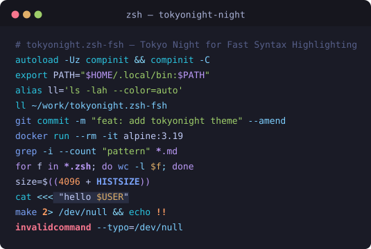
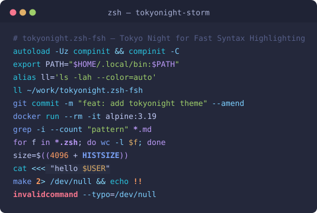
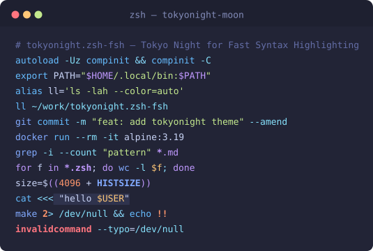
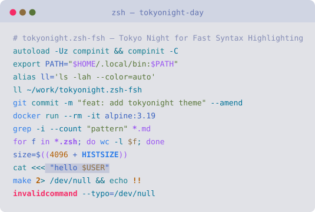

# tokyonight.zsh-fsh

[](LICENSE)
[](https://www.zsh.org/)
[](#variants)

**English** | [简体中文](README.zh-CN.md)

**Tokyo Night themes for [Fast Syntax Highlighting](https://github.com/zdharma-continuum/fast-syntax-highlighting) (F-Sy-H).**

Tokyonight.zsh-fsh brings the four color schemes of [folke/tokyonight.nvim](https://github.com/folke/tokyonight.nvim) — `night`, `storm`, `moon` and `day` — to your zsh command line. Every style key that F-Sy-H exposes is mapped to the matching Tokyo Night palette token, in exact truecolor.

<p align="center">
  
</p>

| storm | moon | day |
| :---: | :---: | :---: |
|  |  |  |

## Features

- **Four variants** — `night`, `storm`, `moon`, `day`, straight from the official tokyonight.nvim palettes.
- **Complete coverage** — all 59 F-Sy-H style keys are themed: commands, builtins, reserved words, aliases, paths, globbing, options, strings, in-string escapes, variables, math, `for` loops, `case`, heredocs/here-strings, redirections, history expansion, bracket matching, recursion (secondary theme) and more.
- **Truecolor** — colors are written as `#rrggbb`; zsh renders them exactly on truecolor terminals and degrades gracefully to the nearest 256-color entry otherwise.
- **Semantics, not vibes** — each F-Sy-H key is mapped to the tokyonight.nvim highlight-group it corresponds to (see the [mapping table](#color-mapping)), so your shell matches your editor.

## Requirements

- [Fast Syntax Highlighting](https://github.com/zdharma-continuum/fast-syntax-highlighting) (F-Sy-H) — `fsh` for short.
- zsh **5.7 or newer** (truecolor support in the line editor). Older zsh versions cannot parse `fg=#rrggbb` styles.
- A terminal with truecolor support is recommended (almost all modern terminals qualify).

Check truecolor support in your shell:

```zsh
print -P '%F{#7aa2f7}this text must be blue%f'
```

## Installation

### Option 1 — installer (recommended)

```zsh
git clone https://github.com/b1nhack/tokyonight.zsh-fsh.git
cd tokyonight.zsh-fsh
./install.sh night    # night | storm | moon | day
```

The script copies **all four** variants to `~/.config/fsh/` and, when run from a shell that already has F-Sy-H loaded, activates the chosen one immediately.

### Option 2 — manual

```zsh
mkdir -p ~/.config/fsh
cp themes/tokyonight-night.ini ~/.config/fsh/
```

Then activate from any shell where F-Sy-H is loaded:

```zsh
fast-theme XDG:tokyonight-night
```

You can also skip the copy entirely and point `fast-theme` straight at the file:

```zsh
fast-theme /path/to/tokyonight.zsh-fsh/themes/tokyonight-night.ini
```

### Make it permanent

F-Sy-H persists the active theme in `$FAST_WORK_DIR`, so `fast-theme` only needs to run **once** — the choice survives terminal restarts. If you prefer a declarative `~/.zshrc`, apply the theme after loading the plugin:

```zsh
# after loading fast-syntax-highlighting
fast-theme -q XDG:tokyonight-night
```

F-Sy-H caches the processed theme (`current_theme.zsh` + `.zwc`), so the per-startup cost is negligible.

## Variants

| Theme | Background | Feels like |
| :-- | :-- | :-- |
| `tokyonight-night` | `#1a1b26` | The default: clean, dark, blue-tinted |
| `tokyonight-storm` | `#24283b` | Softer, stormier blue-grey |
| `tokyonight-moon` | `#222436` | More saturated, "moonhaze" accents |
| `tokyonight-day` | `#e1e2e7` | The light variant for bright terminals |

Switch at any time — switching is just another `fast-theme` call:

```zsh
fast-theme XDG:tokyonight-storm
```

## Color mapping

How F-Sy-H styles map onto tokyonight.nvim highlight groups (hex values per variant):

| F-Sy-H styles | tokyonight.nvim token | night | storm | moon | day |
| :-- | :-- | --: | --: | --: | --: |
| `default` | foreground | `#c0caf5` | `#c0caf5` | `#c8d3f5` | `#3760bf` |
| `unknown-token`, `matherr` | `red` / `error` | `#f7768e` | `#f7768e` | `#ff757f` | `#f52a65` |
| `command`, `single-sq-bracket` | `blue` (Function) | `#7aa2f7` | `#7aa2f7` | `#82aaff` | `#2e7de9` |
| `builtin`, `function`, `alias`, `subcommand`, `precommand`, `back-quoted-argument` | `blue1` (@function.builtin) | `#2ac3de` | `#2ac3de` | `#65bcff` | `#188092` |
| `reserved-word`, `double-paren`, `double-sq-bracket`, `for-loop-operator`, `globbing` | `magenta` (@keyword.control) | `#bb9af7` | `#bb9af7` | `#c099ff` | `#9854f1` |
| `single-`/`double-`/`dollar-quoted-argument`, `optarg-string` | `green` (String) | `#9ece6a` | `#9ece6a` | `#c3e88d` | `#587539` |
| `variable`, `here-string-var`, `case-input` | `yellow` (@variable.parameter) | `#e0af68` | `#e0af68` | `#ffc777` | `#8c6c3e` |
| `path`, `path-to-dir`, `single-`/`double-hyphen-option` | `cyan` | `#7dcfff` | `#7dcfff` | `#86e1fc` | `#007197` |
| `commandseparator`, `redirection`, `here-string-tri`, `for-loop-separator`, `case-parentheses`, `assign-array-bracket` | `blue5` (@operator) | `#89ddff` | `#89ddff` | `#89ddff` | `#006a83` |
| `mathnum`, `for-loop-number`, `exec-descriptor`, `history-expansion`, `optarg-number` | `orange` (@number) | `#ff9e64` | `#ff9e64` | `#ff966c` | `#b15c00` |
| `comment` | `comment` | `#565f89` | `#565f89` | `#636da6` | `#848cb5` |
| `bracket-level-1` | rainbow `blue` + bold | `#7aa2f7` | `#7aa2f7` | `#82aaff` | `#2e7de9` |
| `bracket-level-2` | rainbow `yellow` + bold | `#e0af68` | `#e0af68` | `#ffc777` | `#8c6c3e` |
| `bracket-level-3` | rainbow `green` + bold | `#9ece6a` | `#9ece6a` | `#c3e88d` | `#587539` |
| `paired-bracket` (background) | `bg_search` | `#3d59a1` | `#3d59a1` | `#3e68d7` | `#7890dd` |
| `case-condition` (background) | `bg_visual` | `#283457` | `#2e3c64` | `#2d3f76` | `#b7c1e3` |
| `subtle-bg`, `here-string-text` (backgrounds) | `bg_highlight` | `#292e42` | `#292e42` | `#2f334d` | `#c4c8da` |
| `incorrect-subtle` (background) | `diff.delete` | `#4a272f` | `#52313f` | `#4b2a3d` | `#dababe` |
| `mathvar` | `blue` + bold | `#7aa2f7` | `#7aa2f7` | `#82aaff` | `#2e7de9` |

Full definitions live in the [themes/](themes) INI files.

## Customization

### Overlay (tweak a few styles)

Don't copy and edit a whole theme — use an [F-Sy-H overlay](https://github.com/zdharma-continuum/fast-syntax-highlighting/blob/master/THEME_GUIDE.md). Create `~/.config/fsh/overlay.ini`:

```ini
; overlay.ini — applied on top of the active theme
[base]
comment = #4a557f

[command-point]
command = #89b4fa
```

Apply it (and note that the file must contain the word *overlay*):

```zsh
fast-theme XDG:overlay
```

### Recursive highlighting

Inside `$( ... )` and `eval` arguments, F-Sy-H switches to a *secondary* theme so the nested code reads as distinct. These themes use the shipped **`zdharma`** theme (cool blues/purples that sit well next to Tokyo Night). Prefer a different one — e.g. `clean`? Add this to your overlay:

```ini
[base]
secondary = clean
```

You can even use another Tokyo Night variant if you installed all four (`secondary = tokyonight-moon`).

## Troubleshooting

- **`cannot parse style …: unknown color`** — your zsh is older than 5.7 and doesn't understand `#rrggbb` styles. Upgrade zsh, or convert the INI values to 256-color numbers (`fast-theme -p` prints the palette).
- **Colors look washed out** — your terminal is rendering an approximation, i.e. it has no truecolor support. Verify with the `print -P` check above, and check `$COLORTERM`.
- **Live test block** — `fast-theme -t XDG:tokyonight-night` switches and prints a demo of all style categories.
- **Start over** — `fast-theme -r` resets the active theme (restart the shell afterwards).

## Regenerating the previews

The preview images are SVGs generated from the theme files themselves:

```zsh
python3 scripts/generate_previews.py   # writes assets/preview-*.svg
```

## Credits & license

- Palettes: [folke/tokyonight.nvim](https://github.com/folke/tokyonight.nvim) — Apache License 2.0. Used with attribution; see [LICENSE](LICENSE).
- Theme format, `fast-theme` and F-Sy-H itself: [zdharma-continuum/fast-syntax-highlighting](https://github.com/zdharma-continuum/fast-syntax-highlighting) — BSD-3-Clause.
- This repository: MIT.

